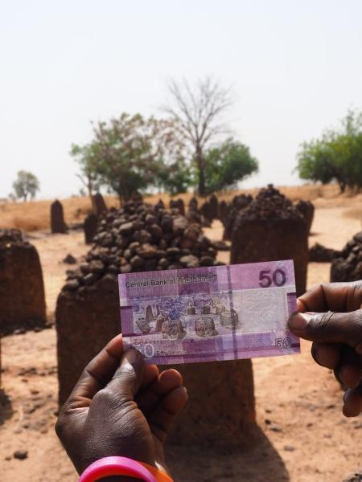

 # Currency of the Year

Challenge by [Saran K](https://sarankanakavel.me)

**Description:** I got nice photo of my Favorite Currency Note. Wonder where it was took?

Flag Format:
`V3CT0R{XX.Xlat±XX.Xlong}`

Here, `XX.Xlat` represent latitude and `XX.Xlong` represent longitude
**Connection Info:** N/A