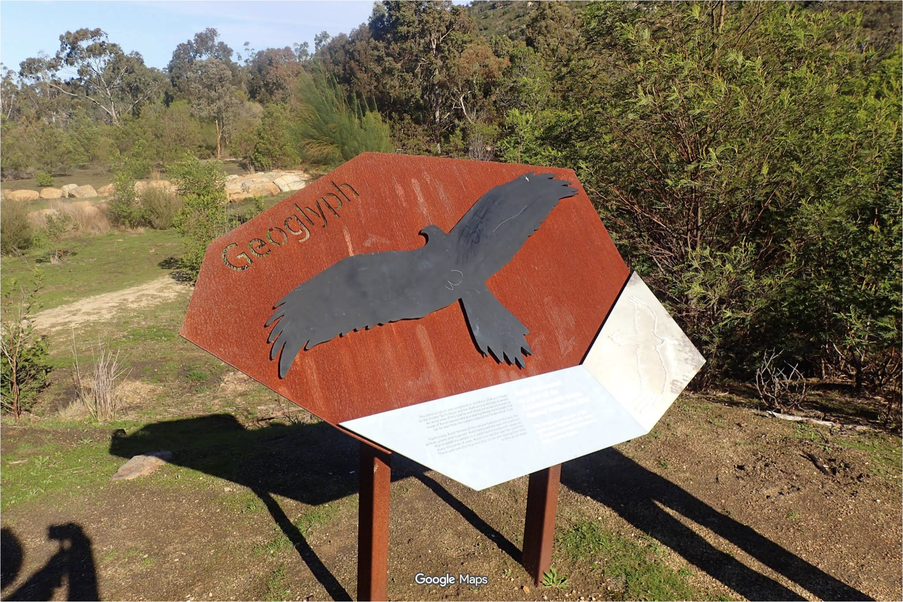

 # Eyes in the Sky

Challenge by [Saran K](https://sarankanakavel.me)

**Description:** A hiker’s photo shows a rusted sign beside a trail. The sign is meant to be read from the ground, but the thing it describes can only be fully appreciated from the air.

Identify the artwork, the person who made it, and the track you would walk to see it from above.

Flag Format:
`V3CT0R{±XX.Xlat±XX.Xlong}`

Here, `XX.Xlat` represent latitude and `XX.Xlong` represent longitude
**Connection Info:** N/A